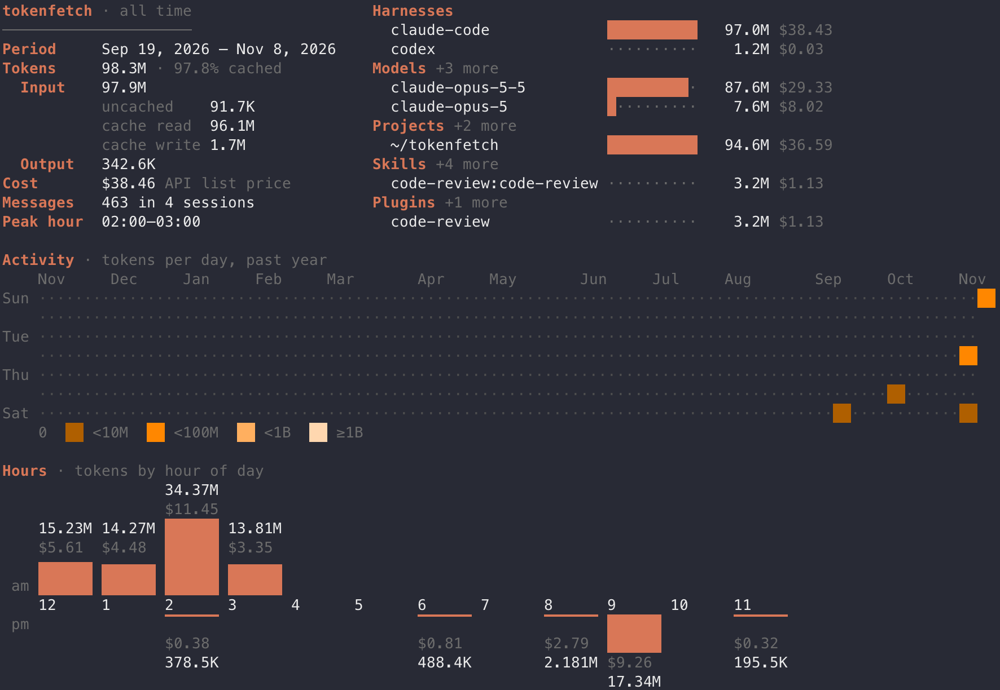

# Tokenfetch

<div align="center">
  <a href="https://github.com/fffelix-huang/tokenfetch/actions"></a>
  <a href="https://github.com/fffelix-huang/tokenfetch/releases"></a>
  <a href="https://github.com/fffelix-huang/tokenfetch?tab=MIT-1-ov-file#readme"></a>
  <a href="https://github.com/fffelix-huang/tokenfetch/graphs/contributors"></a>
  <a href="https://github.com/fffelix-huang/tokenfetch/stargazers"></a>
</div>

Tokenfetch gives summary of Claude Code and Codex token usage and estimated API cost.



## Features

- Usage from every [supported harness](#supported-harnesses), together in one report
- Token totals split into uncached input, cache read, cache write and output, with the cached share
- Estimated cost at Anthropic and OpenAI API list prices (fast/flex tiers, cache writes, long context and data residency included)
- Breakdown by harness (Claude Code, Codex), model, project, skill and plugin — a harness can run any vendor's model
- Activity heatmap, per-day bars, calendar, and hour-of-day charts
- History survives the agents' transcript cleanup
- `--json` output for scripts and other tools

## Supported harnesses

- [Claude Code](https://code.claude.com)
- [Codex CLI](https://github.com/openai/codex)

## Install

Homebrew (macOS, Linux):

```sh
brew install fffelix-huang/tap/tokenfetch
```

Go:

```sh
go install github.com/fffelix-huang/tokenfetch/cmd/tokenfetch@latest
```

Prebuilt binaries are on the [releases page](https://github.com/fffelix-huang/tokenfetch/releases).

## Usage

```sh
tokenfetch            # everything recorded, activity over the past year
tokenfetch --month    # last 30 days, calendar view
tokenfetch --week     # last 7 days, per-day bars
tokenfetch --today    # since local midnight, per-hour bars
tokenfetch --json     # machine-readable report
tokenfetch --help
```

### Record usage in the background

```sh
tokenfetch service install                  # hourly; --interval=daily|weekly
tokenfetch service status
tokenfetch service uninstall                # recorded usage is kept
```

This runs `tokenfetch ingest` periodically (launchd agent on macOS, systemd user timer on Linux), so usage is recorded even if you don't open tokenfetch before the agents delete old transcripts.

### Shell completion

Homebrew installs completions automatically. Otherwise add one line to your shell config:

```sh
eval "$(tokenfetch --bash)"      # ~/.bashrc
source <(tokenfetch --zsh)       # ~/.zshrc
tokenfetch --fish | source       # ~/.config/fish/config.fish
```

## How it works

Tokenfetch reads each [supported harness](#supported-harnesses)'s local session logs, deduplicates streamed responses, and stores one record per model response in a local SQLite database. Each run only reads what was appended since the last run.

Only token counts and metadata (model, project, session, time) are read; prompts and responses are not stored.

**Cost is an estimate.** It applies [Anthropic](https://platform.claude.com/docs/en/about-claude/pricing) and [OpenAI](https://developers.openai.com/api/docs/pricing) API list prices to recorded tokens, by model — whichever harness ran it. On a Claude Pro/Max or ChatGPT subscription you are not billed per token; the figure shows what the same usage would cost on the API. Models without a known price are listed as excluded from cost. Codex doesn't log web searches or the cache-write lifetime, so those are not priced exactly.

**Keep your history.** Claude Code deletes transcripts that haven't been modified for `cleanupPeriodDays` (default 30). tokenfetch keeps everything it has already read, but it can't recover transcripts deleted before it ran. Install the background job (`tokenfetch service install`), or keep transcripts longer in `~/.claude/settings.json`:

```json
{
  "cleanupPeriodDays": 365
}
```

## Development

```sh
make build    # bin/tokenfetch
make test
make lint
make clean
TOKENFETCH_DATA_DIR=/tmp/tokenfetch go run ./cmd/tokenfetch   # use a throwaway database
```

### Release

1. Bump `version` in `cmd/tokenfetch/main.go` and commit as `release: X.Y.Z`.
2. Tag and push:

```sh
git tag -a vX.Y.Z -m vX.Y.Z
git push origin master vX.Y.Z
```

The release workflow checks the tag matches `version`, then [GoReleaser](https://goreleaser.com) builds macOS and Linux binaries and publishes the GitHub release, and the Homebrew formula in [fffelix-huang/homebrew-tap](https://github.com/fffelix-huang/homebrew-tap) is updated to the new tag.
